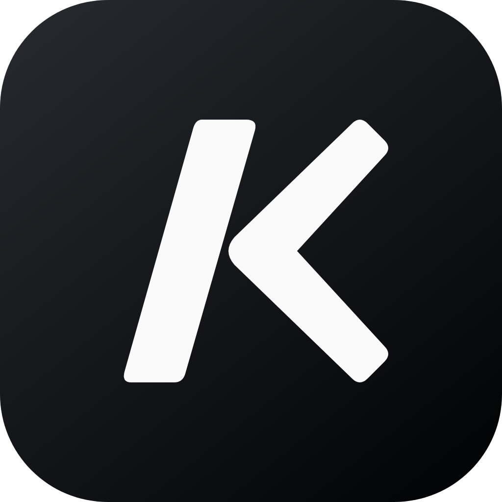
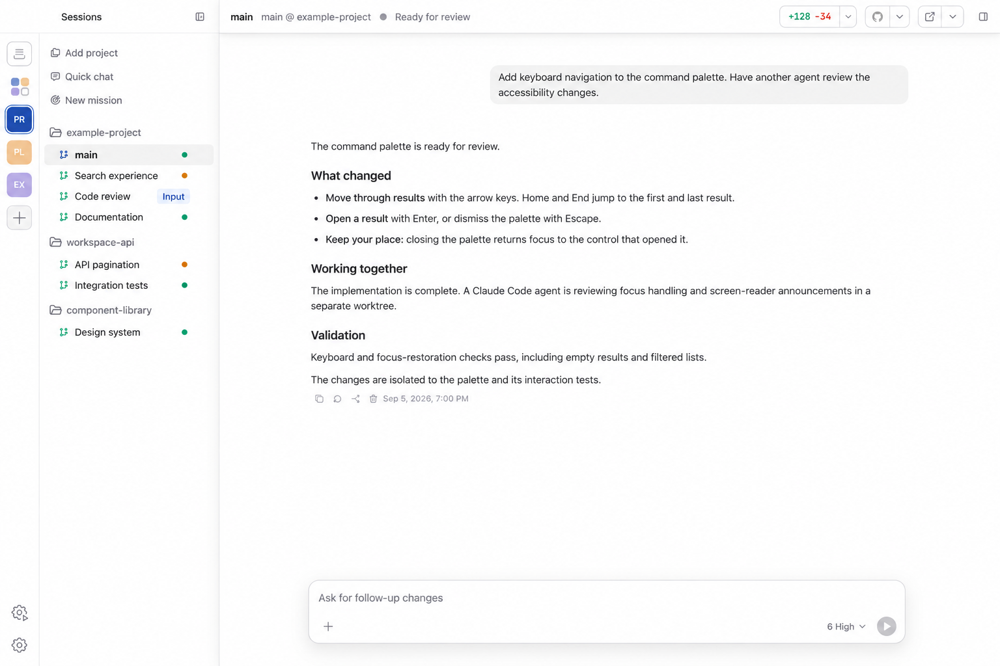

<p align="center">
  
</p>

<h1 align="center">Korus</h1>

<p align="center">
  <strong>Build with agents. From idea to delivery.</strong><br />
  Build with a team of coding agents—across repositories and machines.
</p>

<p align="center">
  <a href="#get-korus"><strong>Get Korus for macOS, Windows, and Linux</strong></a>
  ·
  <a href="https://meetkorus.dev">Website</a>
  ·
  <a href="CHANGELOG.md">Changelog</a>
</p>

<p align="center">
  <a href="https://github.com/Korus-Dev/korus/releases/latest">
    
  </a>
  <a href="https://github.com/nbonamy/korus/actions/workflows/quality.yml">
    
  </a>
  <a href="https://github.com/nbonamy/korus/actions/workflows/quality.yml">
    
  </a>
  <a href="https://github.com/Korus-Dev/korus/releases">
    
  </a>
</p>

<p align="center">
  
</p>

Korus brings your coding agents into one workspace. Use one engine
on its own or run a mixed team: give agents their own conversations and
workspaces, see what everyone is doing, and step in when your input is needed.

Korus is free to use. Connect your provider accounts; provider subscriptions
and API usage are billed separately.

## One cockpit for the whole team

- **Run a real team** — Organize agents into workspaces, give each one a repository,
  identity, conversation, and durable working folder, then switch between them
  without interrupting their work.
- **Choose your engines** — Connect the coding providers you use. Use different
  engines for different agents; available controls reflect each engine's
  supported capabilities.
- **Work across machines** — Connect workspaces on other machines over SSH and
  manage their agents alongside local workspaces.
- **See the work, not a terminal stream** — Follow messages, plans, reasoning,
  tool calls, approvals, command output, file changes, and diffs in a native
  conversation UI.
- **Let agents collaborate** — Agents can discover teammates, share status,
  send messages, queue follow-up work, and coordinate through Korus's
  built-in MCP tools.
- **Bring people into the conversation** — Share a live conversation with a
  collaborator who can follow the work and suggest prompts. You review, edit,
  and send each suggestion, and can stop sharing at any time.
- **Browse without leaving** — Every agent can keep an in-app browser for
  research, local previews, and browser-based tools. Share website sign-ins across
  agents and use Bitwarden or 1Password from the browser toolbar.
- **Teach agents new skills** — Discover curated skills and packs, install from
  GitHub or skills.sh, read their instructions, and sync them across your local
  coding agents in Settings.
- **Use the computer when code is not enough** — Opt-in Computer Use lets agents
  inspect and operate macOS applications while you keep the session visible.
- **Review with context** — Open Git changes, source files, turn-specific diffs,
  Markdown, execution plans, and Plan-mode proposals beside the conversation.
- **Keep Codex work accessible from your phone** — Pair Codex mobile with
  Korus's Codex connection while agents continue running through the background
  backend. This pairing is specific to Codex.
- **Take your team with you** — Pair the iPhone or Android companion with your
  computers, switch saved connections, and follow agents across workspaces. Respond to
  requests and send follow-ups while work continues on the connected computer.
- **Bring your backlog** — Connect GitHub, GitLab, or Linear to browse issues, start
  agent work, or shape a Mission. Choose the code repository separately from a
  Linear team or project. Deliver through GitHub pull requests or GitLab merge requests.
- **Schedule recurring work** — Send prompts to an existing agent or Quick Chat,
  or start a fresh Quick Chat each time. Choose daily, weekday, weekly, custom,
  or interval schedules, or ask an agent to create an automation from chat.

## From idea to delivery

- **Missions** — Shape a feature through Requirements, Tickets, Implementation,
  Review, and Ship. Approve the brief and tickets, follow workers across
  repositories, review findings, and deliver through pull requests or merges.
- **Delegate** — Discuss a task, then use `/delegate` (or `/worktree`) to send a
  self-contained handoff to a new Korus teammate in a dedicated worktree. Your
  original conversation stays open; pushing and merging remain separate decisions.
- **Review** — Use `/review` to assess a branch or uncommitted changes with an
  independent reviewer or the current agent. Inspect structured findings,
  choose which fixes to apply, and run another review round. Save shared review
  instructions in Settings → Workflows.
- **Visualize** — Use `/visualize` to explore designs on an editable diagram
  canvas beside the conversation. Annotate a shape to request a targeted change
  without losing your other edits.
- **Hand off** — Continue an idle task with a replacement agent, optionally
  switching engines or models. The current agent writes a handoff note; the
  replacement works in the same folder, with the source history still accessible.

Review, Delegate, and Visualize are also available from the composer's **+** menu.

## Built around your workflow

Create agents from repositories and give each one a prompt, then move freely
between active conversations: drafts, attachments,
queues, model settings, browser tabs, and sidebar state stay with the agent.

Queue a follow-up while an agent is working; Korus sends it when the current
turn finishes. Both Codex and Claude Code support steering; Claude receives the
update at a tool boundary or in a following turn, rather than immediately
interrupting a running tool. Claude also supports idle conversation forks in
the same folder and native goals; its goals do not support token budgets.

Keep two or four agents visible in split panes, with one shared artifact sidebar
following the focused agent. Resize panes and keep each workspace's layout across
restarts. Let project creation, worktree setup, and cleanup run in the background
while you continue working. With the background backend enabled, closing the
desktop app leaves the team running. Saved workspace state is restored when
you return.

When a provider supplies a usage-limit reset time, Auto-resume can continue the
conversation after the reset. Compare token usage, estimated API costs, and
output speed over time in Settings → Analytics. Usage statistics and cost
calculations stay on your computer.

## Get Korus

Korus is available for macOS on Apple silicon, Windows x64, and Linux
x64/ARM64. Download it from [GitHub Releases](https://github.com/Korus-Dev/korus/releases).
Prereleases require manual downloads; automatic updates
on macOS and installed Windows copies follow stable releases only. Windows
installers are unsigned. Linux and portable Windows updates are manual.
To run from source, see [Development](#development).

1. Download a published installer for your platform and architecture from GitHub Releases.
2. Install and launch Korus:
   - **macOS:** Open the DMG and double-click Korus to install and launch it.
   - **Windows:** Run the installer, or extract the portable ZIP and launch Korus.
   - **Linux:** Install the DEB or RPM for your architecture, or extract the ZIP
     and launch Korus.
3. Install and connect a coding engine, then choose Continue. Only one connected
   engine is required. See the [provider guides](website/docs/providers/index.md)
   for installation and sign-in, including Antigravity's ACP runtime.
4. Create a team, add an agent from a repository, and start coding. When multiple
   engines are enabled, choose which one the agent uses.

Korus uses your existing Codex and Claude Code setup by default, including their
sign-in. Choose Customize during setup to keep Korus conversations in a separate
environment instead. A separate setup requires its own sign-in.
You can also share existing provider skills with a separate setup. Settings shows
each engine's account, conversation location, and enabled state.

## Terminal recovery

The standalone CLI can inspect an installation and prepare a support session even
when the desktop app or backend cannot start. It requires Node 26; terminal triage
automatically uses an installed, authenticated client in this order: Claude,
Codex, then Antigravity (`agy`). It can also prepare prompt files for another agent.

Build it from this checkout:

```bash
npm run build:cli
node client/cli/dist/cli.mjs doctor
node client/cli/dist/cli.mjs triage
```

`doctor` performs bounded, read-only probes. `triage --no-launch` prepares private
context and troubleshooting instructions without starting an agent. Its playbook
requires approval before recovery actions or uploads.

Use `--agent claude`, `--agent codex`, or `--agent antigravity` to choose a client
explicitly. Authentication checks are bounded and do not start a model turn;
clients whose authentication cannot be confirmed are skipped during automatic
selection. If none is ready, the generated prompt and context remain available.

| Command | Purpose |
| --- | --- |
| `doctor --json` | Inspect state envelopes, versions, provider executables, daemon socket and an advertised loopback MCP endpoint. |
| `backend status` | Check the daemon socket. A desktop-owned stdio backend can run separately. |
| `backend start`, `stop`, `restart` | Control the installed macOS background service, with confirmation or `--yes`. |
| `logs --since 15m --follow` | Tail recent redacted logs; `--agent ID` filters one agent. |
| `support bundle` | Prepare a redacted metadata bundle locally. `--include-logs` adds excerpts to inspect before sharing. |
| `agents list`, `missions list` | Inspect live state, with saved-state fallback clearly labelled. `--offline` skips connection attempts. |
| `missions show ID` | Inspect ticket progress and worker recovery counts. |

Use `--home` or the existing `APP_HOME`/`KORUS_HOME` override to select an
installation. `--socket` or `APP_BACKEND_SOCKET` selects an existing daemon socket.
No command starts a daemon implicitly. Use `--help` for limits and other options.
On Windows, native provider executables can launch triage; `.cmd`/`.bat` wrappers
can use `--no-launch` and open the generated prompt in their provider manually.

For an installable package, run `npm pack ./client/cli/dist` and install the
resulting tarball with `npm install --global /path/to/the-tarball.tgz`. The `korus`
command then works outside the checkout, without Electron or provider SDK packages.
Support bundles are never uploaded automatically; inspect their contents before sharing.

## Development

Requirements:

- macOS arm64, Windows x64, or Linux x64/arm64;
- Node 26 (use the exact version pinned in [.nvmrc](.nvmrc)) and npm 10.9.4;
- a connected account for at least one [coding engine](website/docs/providers/index.md).

Use this reference toolchain for local development and checks to match CI.
The packaged desktop app includes its own Node runtime; users do not need to
install Node to run it.

```bash
npm ci
node node_modules/electron/install.js
npm run dev
```

Workspace manifests pin `@korus-dev/multi-agent-sdk` and `@korus-dev/agent-ui-sdk`
npm packages; the lockfile is the dependency boundary. No sibling checkout is
required. SDK contributors can set `SDK_LOCAL_SOURCE=1` in `.env` to use local
source. `SDK_SOURCE_ROOT` selects the directory containing the three SDK
repositories, defaulting to the parent directory. Local runtime builds use source;
typechecking uses locally built declarations. `npm run dev` builds them first.
Install Electron once before running parallel tests: its lazy first-import
download can otherwise race across workers on a clean checkout.

On Windows, run development from PowerShell with Node and npm installed. The
launcher invokes npm through Node, so it does not require a Unix shell or direct
execution of `npm.cmd`. Korus detects provider runtimes on PATH; **Install** in
Welcome and Settings opens external installation instructions. Provider runtimes
are not bundled with Korus or automatically installed by its build.

Focused project gates:

```bash
npm test
npm run test:coverage
npm run lint
npm run typecheck
```

Builds consume the pinned Computer Use artifact and verify its checksum. Set
`COMPUTER_USE_LOCAL=1` in `.env` to build the helper from a sibling
`computer-use` checkout instead.
Computer Use and AppShots are macOS-only. Windows and Linux builds skip the
Computer Use helper and do not package its native automation dependency.

macOS release packaging signs and notarizes by default. For local packaging
checks that do not need signing:

```bash
APP_SKIP_SIGNING=1 npm run package
```

Once the prepared release commit is pushed, **`npm run prerelease`** builds and
publishes a prerelease; **`npm run latest`** builds and publishes a stable release.
Both infer the version from package.json, create the missing version tag, and
monitor one GitHub workflow through
quality checks, all four platform builds, and publication. Installers are
uploaded by GitHub runners; there is no combined bundle or separate publishing
workflow.
See [GitHub desktop releases](docs/backend-architecture.md#github-desktop-releases)
for the target matrix, launch/monitor commands, signing setup, and publication.

### Native companion development

Run the relay on its own, in a separate terminal:

```bash
npm run dev:relay
```

It serves the plain `ws://localhost:<port>` address from `APP_COMPANION_RELAY_URL` (the
repository `.env` sets it) for the local daemon's laptop identity; plaintext is accepted
only on loopback and no certificate is involved. On start it prints its identity for
`APP_COMPANION_RELAY_PEER_ID`. Start the desktop app once beforehand so the laptop has an
identity. It rebuilds the relay bundle on every start.

The iOS companion connects to the owning laptop daemon through a WSS relay. The relay
is deployment configuration shared by the laptop and the phone build:

```bash
APP_COMPANION_RELAY_URL=wss://relay.example
APP_COMPANION_RELAY_PEER_ID=<relay identity printed by the relay at startup>
```

The daemon reads them at runtime (desktop app environment or `.env`); set them as GitHub
variables for the production pipeline. With a relay configured, Settings → Connections →
Mobile access offers Pair phone, which shows a short code like `K7QD-M2XP` (and a QR code
of it). Entering it in the companion app pairs the phone; a new phone then needs your
approval on the desktop, which grants it every team and prompt sending.

Relay operators build the standalone artifact with
`npm run build:relay -w @workspace/backend`. Container packaging lives in
`client/backend/companion-relay/`: supply a reviewed Node image pinned by digest, a valid
public TLS certificate, a persistent identity volume and admitted laptop PeerIds.
The compose configuration maps outbound-facing WSS port 443 to the container's
8443 listener. Health checks remain inside the container. Relay deployment and
native signing are separate from building these artifacts.

## Architecture

Korus separates the desktop shell from the long-running agent backend:

```text
Vue renderer → typed preload IPC → Electron main → daemon → backend driver
                                                          ├─ Codex app-server
                                                          ├─ Claude Agent SDK
                                                          └─ Antigravity ACP
```

Electron owns native desktop integration. `daemon` owns agent runtime state,
persistence, collaboration, backend processes, git, approvals, and background
work. The renderer consumes app-owned events rather than provider protocol
types.

## Documentation

- [User guide](website/docs/index.md): setup, providers, workflows, features, and troubleshooting.
- Run `npm run docs:dev` for a local VitePress preview, or `npm run test:docs`
  to build the public website and check its generated documentation links.
- [Architecture](docs/architecture.md)
- [Backend protocol](docs/protocol.md)
- [Codex integration](docs/codex.md)
- [Claude Code integration](docs/claude.md)
- [Antigravity integration](docs/backend-architecture.md#antigravity)
- [Agent collaboration and MCP](docs/mcp.md)
- [Frontend conventions](docs/frontend.md)
- [Testing](docs/testing.md)
- [Contributor agent instructions](AGENTS.md)

## License

Apache-2.0. See [LICENSE](LICENSE).
