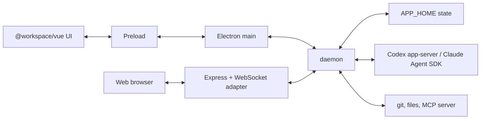

# Architecture

Korus is a desktop (and local web) app for coordinating teams of coding agents
with native conversation and artifact rendering. It does not embed a terminal.
Provider runtimes (Codex app-server, Claude Agent SDK) run behind `daemon`; every
client renders app-owned state and provider-owned conversation frames.

Product identity (names, paths, MCP namespace) comes from `core/src/product.json`.
Implementation identifiers stay brand-neutral. Types, method names and event
unions live in `core/src/`; this document records only what the code cannot say:
ownership, invariants and the reasons behind them.

## Process Model

**Rule:** an operation that acts on a repository, agent, provider session, work
item, transcript or backend-owned path belongs in `daemon`. An operation that asks
the local desktop to show UI or use an OS affordance belongs in Electron main.

- `daemon` owns product state and its only writer, provider processes and
  protocols, approvals, git, files, worktrees, automations, work integrations,
  the MCP server and runtime state. Clients never read backend-owned paths: file
  previews are `agentId` requests, and absolute or `file://` transcript links are
  normalized to agent-relative paths or forwarded to the owning daemon.
- Electron main owns windows, menus, dialogs, deep links, native permission and
  speech helpers, packaged resource paths, and the stdio/socket client to
  `daemon`. It adopts snapshots returned by backend RPCs and never derives product
  state itself. `daemon` supplies a derived `ClientState` for the few native
  decisions that depend on product state (dialog defaults, display sleep).
- Deep links are an automation interface: `korus://new?prompt=…` and
  `korus://agents/<id>?prompt=…` submit by default (`submit=false` prefills the
  composer). Electron converts accepted URLs to typed `AppCommand`s; raw URLs never
  cross preload.
- The renderer owns visual state. It never talks to a provider, spawns tools,
  reads local files, or imports provider protocol types.
- Preload is a small typed bridge and the only renderer path to Electron.
- Web is a local, single-user host: loopback only, fixed identity, an allowlist of
  product operations, and a `daemon` runtime without Computer Use or browser MCP
  tools. It is not a public-deployment foundation.

The local mobile simulator host owns device attachments and native command execution
in Electron. Its pane and provider-independent MCP tool share that authority;
[the MCP model](mcp.md#mobile-simulators) records the attachment and coordinate rules.
Normal video teardown settles pending reads with an ended result; cleanup is
idempotent and cannot stop a replacement view. Native stream failures remain errors.

Host capabilities are enforced in `daemon` as well as in the UI: a persisted
desktop preference cannot enable a tool the host does not provide.

### Workspaces

| Package | Owns | May depend on |
| --- | --- | --- |
| `core` | contracts, protocol types, pure reducers/policy, client ports; no Node, Electron or Vue | none |
| `backend` | `daemon`, provider drivers, MCP, persistence, git/files, automations, work providers | `core` |
| `vue` | reusable product shell, receives a typed `AppClient` at bootstrap | `core` |
| `electron`, `web` | host composition roots | `core`, `vue`; start a built `daemon` artifact, never import backend sources |
| `mobile` | native mobile shells, companion engine, and shared Vue transcript | `core`, `vue`; no Electron, provider process or backend filesystem authority |

Cross-package imports use package names, never deep relative paths. `core` stays
runtime-thin so every client shares one contract without inheriting file authority.

The mobile companion engine is a narrow workspace/read/send port over the companion
protocol. SwiftUI and Jetpack Compose own native navigation and the composer. On iOS,
app-lock protection uses a separate scene window above native sheets and full-screen
presentations when authentication is required; brief app switches within the unlock
grace period retain the last screen.
Locked settings cannot disable protection. A background WKWebView hosts
the TypeScript engine; a separate WKWebView renders authoritative provider snapshots
through the shared Vue conversation pane without a transcript reducer. Native safe
area insets reserve the header and composer space, including the scroll-to-bottom
control. Android uses separate engine, transcript and changes WebViews at a bundled
HTTPS asset origin. Its main-frame message port is restricted to that origin and
page; encrypted pairing storage uses AndroidKeyStore.
Retained Android pages use application-derived themed contexts with the native
window's configuration. Appearance changes preserve the transport and provider
replica without retaining the window's Activity. Transcript presentation waits
for a mounted, measured native viewport before requesting a paint acknowledgment.
Read acknowledgments also require the engine's current ready generation. Native
loading presentation lasts through the selected frame's paint; a retained transcript
stays usable during reconnects. Android bounds page startup and rendering by foreground
visibility, replaces failed WebViews for retry, and retains native composer drafts across engine
recovery without replaying uncertain sends.
The bundled native bridge initializes the transport's required browser compatibility
APIs before the companion starts; an older system WebView must not silently lose pairing.
Android app lock uses system device-owner authentication and the same unlock grace.
Application activity visibility owns that grace so transferring to the internal
scanner does not count as backgrounding. Camera frames are decoded locally through
a bundled QR decoder; only a complete pairing code can leave the scanner. Analysis
releases every frame and rejects queued results after a pause or dismissal.
Locked presentation removes native sheets and image dialogs; navigation remains
model-owned. Both native shells gate activity and read acknowledgments
on an unlocked screen; notification navigation waits for authentication.
Android instrumentation uses a separate application ID so tests cannot replace a
paired development installation. Native drafts and attachment imports retain the
complete host/conversation target through navigation and delivery acknowledgment.
Android reads picker-granted content URIs on a worker, normalizes photos before
upload, and exposes only its temporary camera directory through FileProvider.
Camera source files are removed after processing or cancellation. History requests
route through the owning daemon to provider-owned paging.
Native image viewers consume displayed image bytes or web URLs, never laptop paths.
The transcript resolves host files through the engine before opening the viewer.
Android shares its bounded worker-based loader and native zoom surface between
conversation images and composer attachments; late image events cannot open over a
different selected conversation or a locked screen.
Native composer completions use the engine's scoped skill and mention catalogs.
Chips are presentation metadata over canonical prompt text; editing and copying
preserve full tokens and their UTF-16 selections. Catalog loading and target
invalidation stay in the engine rather than a second native catalog cache.
Native sidebar organization and idle-sort preferences belong to a host/team pair.
The engine projects activity groups and their order; native clients render those
groups with stable agent identity across activity transitions.
Recent mobile provider replicas are retained in memory independently of the connection.
Hidden subscriptions expire without deleting their last usable content; count and byte
budgets evict older entries. Reconnection revalidates the full host, team, provider and
session identity before enabling conversation actions. Forgetting a host clears its cache.
A capable daemon accepts a conversation checkpoint and replays a bounded journal of
opaque provider events, or acknowledges an unchanged conversation without a transcript.
A reset changes the checkpoint generation; unavailable continuity falls back to an
authoritative snapshot. Older daemons retain the snapshot subscription protocol.
The iOS transcript page retains provider-owned replicas and receives checkpointed batches
through the native bridge. Each batch covers updates since the page's last painted
acknowledgment, so the latest pending batch can replace older pending work without losing
events. A missing page replica requests a full baseline. Native code routes opaque payloads;
it does not reduce provider conversations. Android receives paced whole-conversation
transfers, capped at ten per second. Context-only changes travel separately on both clients.
Cached content stays readable during refresh; iOS distinguishes initial loading, updating,
offline viewing and retryable refresh failure. Freshness and read acknowledgments require
the selected connection generation and its rendered content. Unchanged workspace parts
keep their identity to avoid unnecessary derived updates.
Git changes use a separate bundled web view with the shared desktop diff renderer.
Native controls own its scope and presentation, bound to the captured conversation.
Closing or replacing that conversation clears Android's native patch cache. Patches
cross a separate, on-demand bridge event rather than repeating in workspace or
conversation state.
The native side routes on an event type without parsing the transcript payload, hands
the page one message at a time, and replaces anything that piled up with the newest.
Unread activity belongs to the owning daemon and persists with each agent. Clients
acknowledge the attention revision they displayed; older acknowledgments cannot
clear newer activity. Desktop and companion indicators consume the same metadata.
The phone acknowledges only its rendered, unlocked foreground conversation with the drawer
closed; cached subscriptions and background updates never count as reading.
Android suspends read acknowledgments while a notification target is being validated.
A failed navigation can reuse the painted receipt only while its full conversation
identity and generation remain current.

Mobile attention alerts originate from live completed-turn and normalized request
creation events in the owning daemon. Snapshots do not create alerts. An event ID
binds the host, conversation and turn/request across the foreground stream and push;
native presentation suppresses duplicates and the visible conversation. A live
foreground phone receives only the in-app stream, without a system push. Stream closure
or an expired inbound heartbeat restores push eligibility independently per device.
Desktop-originated turns suppress push while Electron reports current focus;
mobile-originated work and unknown origins remain eligible. Prompt provenance is
volatile, scoped to the turn, and carried through in-process queued admission.
It never changes provider conversation state. Desktop focus failures leave push
available rather than retaining stale focus. Suppressed alerts are not replayed.
Banner dismissal does not acknowledge unread activity. Notification navigation retains
the latest tap through startup, app unlock and connection restoration, then validates
the paired host and current full conversation target before opening it. Explicit
navigation or forgetting the laptop cancels a pending tap; connection interruptions
are not evidence that its conversation is missing.
Push device tokens belong to each authenticated pairing and are persisted privately
with its grant; revocation removes them. The relay holds APNs signing keys and FCM
service-account credentials and accepts bounded, rate-limited requests only from admitted laptops for
their registered phones, with phone-signed consent scoped to the relay, laptop,
token, push service, environment and expiration. Existing Apple consent bytes remain
compatible; FCM consent explicitly binds the push service. Public relay admission
needs no account or operator enrollment; pairing proof and desktop approval still
gate access.
Push providers receive agent names, attention kinds and opaque navigation IDs, never
conversation text, prompts, approvals or tool arguments.
Foreground APNs delivery uses the same native banner path with system presentation
suppressed; background delivery belongs to iOS. The native app bundle ID and APNs
topic both use the product app ID. Sandbox and production credentials are separate.
Android initializes Firebase only with configured client metadata and notification
consent. It registers the installation with FCM and presents data-only messages
through the same native inbox as foreground events. System notification taps retain
the captured target; opening or dismissing an alert does not substitute for the
engine's validated navigation and rendered-conversation read acknowledgment.
Firebase initialization, registration and revocation run on a serial worker;
completion returns to the main thread and cannot override newer consent state.

Companion workspace subscriptions ignore context-usage, turn-diff and file-activity
events: those projections are absent from the mobile workspace, and conversation
content travels through the subscribed provider stream.
Native request forms consume the engine's app-owned questions and approvals. Replies
retain the request's full host, location, team, agent and session identity; the engine
owns delivery and reconciliation. Android holds answer drafts, including secret fields,
only in its ViewModel and invalidates them when the request disappears or changes its
questions. Opening a request suspends dictation and conversation read acknowledgments.
Mobile prompts start a turn when idle. For active work, the phone defaults to
steering and supports a saved queue preference and per-message overrides. The owning
daemon decides at admission time and owns the same queue shown by desktop and mobile;
the phone receives queued text without host attachment paths or provider options.
Queue steering and deletion name the captured conversation and queued prompt; the
owning daemon applies the desktop queue operation and publishes the resulting queue.
Durable companion receipts cover queue admission and steering, so reconnecting cannot
replay an accepted or uncertain prompt.
Receipts distinguish active admission from a confirmed rejection and an unknown
provider outcome. The phone reconciles timed-out admissions while connected,
without replaying them; late acceptance clears only the captured native draft
and attachments. An unresolved outcome keeps its warning and draft but permits
an explicit new send after the user checks the conversation.
The composer microphone uses Apple's Speech framework on iOS and Android's on-device
recognizer on Android 12 or later, with native microphone permission. An unavailable
local recognizer never falls back to a network service. Audio stays on the phone;
partial and final transcripts update only the captured active draft. Results can reset after
silence, so completed utterances are retained separately from the current hypothesis.
Successful recognition rollover preserves the draft and keeps listening until stopped.
Sending, navigation, backgrounding and locking stop capture and invalidate late
permission and recognition callbacks. Startup and final recognition waits are bounded;
a stalled recognizer releases the editor with its latest words intact.
Keyboard dictation remains available through the system text field.

On iOS, pairing identities, laptop records, and each laptop's last-opened team and agent use
device-only Keychain entries accessible while unlocked. Selection restoration checks
the connected workspace and falls back in desktop team/agent order. The engine's
optional protected draft store persists prompt intent
and delivery uncertainty by laptop and agent; its native host keeps composer text
and selected attachment bytes in memory, keyed by the full laptop/conversation target.
Pending first-send drafts follow initialization of their empty provider session;
established-session replacements keep separate drafts. Native pickers and explicit
clipboard paste supply bounded bytes, never device paths.
Goal mode is a native draft choice; setting and clearing use target-bound companion
commands routed to the same daemon goal operations as desktop. The native goal bar
reads the daemon's goal projection, and uncertain delivery retains the objective
without replaying the mutation.
Review initialization reads the desktop's Git scope and reviewer model catalog through
a target-bound companion request. Native choices use the existing review-start input;
the daemon remains the owner of review execution and findings. Opening setup does not
start a review, and automatic fixes and local commits require explicit selection.
The companion engine validates the target before submission and reports admission
back to the native draft; only accepted sends clear their captured text and attachments.
The laptop stores uploads privately and passes ordinary provider attachment paths
through its existing prompt route. Nested remote teams remain text-only until their
owning host supports trusted file transfer. Reconnect reconciles available command receipts without replaying prompts
and retains the last loaded snapshot while rehydrating the same provider session.

Repository branch selection uses the desktop branch catalog on the repository’s
owning host. The phone receives names and checkout status, never checkout paths;
chat creation resolves the branch again and reuses its checkout or creates a
worktree on that existing branch.

Mobile access belongs to the existing owning daemon. A dedicated libp2p companion
protocol runs through an outbound WebSocket circuit relay, with Noise authenticating
and encrypting the laptop-to-device channel. A phone pairs with a short code that
expires after five minutes and is claimed by one authenticated phone. The pinned
relay is trusted for this initial identity introduction; subsequent connections use
the saved laptop and phone identity pins. Explicit desktop approval is required;
an approved phone can read every team and send prompts. The relay carries
conversation ciphertext, connection metadata and optional push attention metadata;
its leased host registrations, temporary claimed-device routes and traffic bounds
constrain routing. Endpoint authorization constrains app methods and location/team/agent/session
targets. Local revocation persists before closing device connections. The local web,
MCP and daemon socket transports retain their existing exposure boundaries.
Native Debug builds may use WS for their configured relay on local Wi-Fi without
a TLS certificate; Noise and pairing still apply. Release builds require WSS
outside loopback, and saved pairings cannot enable the development exception.

## Conversation Ownership

Provider conversations stay provider-owned end to end. Codex messages, turns,
optimistic submissions, history, queues and mutations belong to `codex-app-sdk`;
Claude's normalized transcript belongs to the Claude conversation host in
`backend/src/claude/`. Korus stores the provider session reference, transports
frames inside an app-owned envelope (agent, provider, revision), invokes SDK
operations, and adds coordination metadata.

- `daemon` publishes one bounded provider reset followed by revisioned deltas.
  Electron forwards frames unreduced. The renderer keeps one provider replica per
  agent, rejects stale or gapped revisions, and rehydrates instead of repairing.
- `AppSnapshot` and `snapshot/get` are transcript-free. Streaming never grows
  them, and an unrelated agent change cannot invalidate an open transcript.
- Korus derives only read-only projections (status, unread, plans, diffs, file
  activity, sidebar activity). A projection never constructs, reorders or mutates
  provider messages or turns.
- **Design test:** if a change makes Korus remember provider message identity or
  reproduce an SDK reducer transition, the seam is wrong. Fix the SDK or host and
  make Korus thinner. Product policy belongs in the driver; generic conversation
  behavior belongs in the SDK.
- Provider parity is expressed through capabilities and product
  actions, never through a lowest-common-denominator transcript.

## Backend Seam

Every backend-dependent feature enters through the app seam:

1. Define an app-owned contract for behavior outside the transcript.
2. Add or extend an optional `AgentBackendDriver` method or capability behind
   `daemon`. Optional methods are the parity boundary.
3. Keep provider details in `backend/src/codex/*` or `backend/src/claude/*`.
4. Route renderer requests through preload, `BackendClient` and the app-owned
   protocol ([protocol.md](protocol.md)). Renderers may branch on capabilities or
   empty data, never on provider protocol types.
5. Test the seam: fake-driver routing, provider host behavior, replica revision
   handling, and Korus-owned decorations.

For providers with archive support, every live agent owns exactly one
non-archived conversation. Restart and close archive it before clearing app state
(a failed archive fails the operation). Startup reconciliation archives
unreferenced top-level conversations and restores an archived one still
referenced by a live agent. Resume is a compensating switch: restore and load the
target, archive the displaced conversation, then persist the new reference.

## State

`daemon` persists versioned JSON under the backend home (`~/.korus`, override
`APP_HOME`; Electron never passes its data directory):

| File | Content |
| --- | --- |
| `roster.json` | teams, agents, automations, missions, work assignments, review ledgers |
| `settings.json` | preferences, theme, source folder, remote connections, work integrations |
| `document-workspaces.json` | per-client, per-agent open tab references and transient Markdown backing bytes |
| `tasks.json` | durable delegated tasks (additive; absent means none) |
| `visualizations/<repo>-<hash>/<id>.json` | user content, one file per visualization |
| `backups/` | verified copies taken before a migration |
| `provider-tokens.json` | work-integration tokens, owner-readable, behind a token-store port |

Rules:

- Every file is `{ schemaVersion, writtenBy, data }`. A build refuses to read or
  rewrite a newer `schemaVersion`; a file that fails to parse stops startup rather
  than becoming empty (except an unreadable visualization, which is skipped).
- Within a supported schema version, additive fields do not block loading agents,
  settings, tasks, document workspaces or visualizations. Known field types and task
  lifecycle invariants remain validated; command inputs retain their own strict validation.
- Agents with an unknown engine kind are excluded from runtime state and logged.
  The store preserves their opaque records, team membership, work assignments and
  subagent data across ordinary saves; it never converts them to another provider.
  Known engine kinds still require valid provider data.
- Bump the version only for breaking changes, with a typed step in
  `backend/src/persistence/migrations.ts`. Additive optional fields and
  backward-compatible defaults need no migration even if an older build drops them.
- Roster schema 2 protects prompt-target automations and calendar recurrences from
  repository-loop readers. Loading a schema-1 roster takes a verified backup and
  upgrades its envelope before normal saves; valid prompt schedules are preserved,
  while obsolete repository loops are not converted. Other files retain their own
  schema versions. Older builds refuse the roster instead of silently deleting
  schedules they cannot interpret.
- Writes are serialized, same-directory temp file plus atomic rename, with no
  fsync and therefore no power-loss guarantee. A slow older write never overwrites
  a newer one.
- Navigation, ordering and presentation settings are per-client preference
  profiles; backend policy is shared. A client selecting a remote team never
  changes the remote desktop's navigation.
- Document tabs own transient Markdown lifetime. Display persists the bytes and
  open references before emitting a client effect. If retention fails, display
  proceeds without durable backing and logs the failure. One atomic document store uses
  the same client identity as presentation preferences; closing the last reference
  collects only its backing bytes, never a repository file. File tabs retain paths
  and reopen through the owning host. Save As writes first, converts the same tab,
  then releases its transient reference. A failed save retains the original bytes.
  The local backend retains forwarded remote displays for its own clients; remote
  file reads and saves still route to the owning host. No provider traffic is replayed
  to restore tabs, and no document library or closed-tab history is retained.
- Not persisted: provider transcripts, live provider request handles, runtime
  catalogs, finished plans/goals, resolved plan reviews, subagent activity,
  provider connection observations, browser page state.
- Persisted Git remote identities are canonical and credential-free.
- `sessionKind` distinguishes quick chats from agents; Git identity only enables
  repository grouping and actions. Closing a quick chat deletes its provider
  session (archive if the driver cannot delete); closing any other agent archives.

### Provider Homes

Codex and Claude default to their existing CLI homes for unconfigured setups;
saved home choices and legacy conversation locations are preserved. Local
providers can use a separate home with its own provider sign-in. Isolated homes
are `~/.korus/codex-home`, `~/.korus/claude-home`, and
`~/.korus/antigravity-home`; existing homes follow provider-specific launch
configuration. Antigravity uses `GEMINI_HOME`, otherwise `~/.gemini`, for its
existing setup. Personal skills (and Codex plugins) can be linked from the
existing home (`providerHomes.<backend>.shareSkills`); private resources are
never overwritten. Credentials are never copied; an isolated home authenticates
on its own. Existing-home changes affect the user's external provider setup too.

The daemon skill manager keeps downloaded skills in `APP_HOME/skills`, with
revision receipts and provider-owned skill-directory links. Installs resolve
GitHub references to commit hashes and copy complete skill folders without
executing installer commands. Sync adds links for newly configured local
providers; personal directories and links are preserved on conflicts. Confirmed deletion removes a skill from all discovered local provider roots and
its managed content, including owned links in previously selected homes. Linked
skill folders are unlinked without deleting their external source; nested skills
inside linked packs must be removed by their pack installer. System skills are
protected using both discovered and resolved paths; any protected installation
blocks deletion of the grouped skill across providers.
The installed inventory also discovers existing skills in native provider homes
and read-only provider roots, including Codex's global user skill directory.
Discovery follows linked skill folders with bounded traversal and groups presence
by skill name; presence does not imply matching versions across providers.
Personal and bundled skills are never adopted or removed by inventory or Sync.
Document reads return distinct installed SKILL.md contents without executing them.
Remote hosts manage their own installations. Existing local agents receive a
refreshed skill catalog without replacing their conversations.

Switching between an isolated and an existing home is an explicit roster reset:
the client confirms the exact local agent IDs (quick chats included);
`ProviderSetup` rechecks after async preparation, refuses active agents and
unfinished linked review/Mission work, takes verified backups, pauses app RPC
mutations, and restores the old home and roster on failure. Provider
conversation files stay in the old home, and switching back does not recreate the
removed agents. Remote agents and other providers are untouched.

## Location Routing And Remote Teams

A local `daemon` is the control plane. A remote team is a local pointer
(`Team.remoteConnectionId` + `Team.remoteTeamId`); the remote `daemon` owns its
agents, sessions, files, git, worktrees and prompts. Agents never move between
backend locations.

- `Team.id` is the local pointer ID. `remoteTeamId` is foreign state: never use it
  for local membership, active-agent repair, assignment cleanup or migration, and
  expect it to collide with local IDs.
- Location-scoped and agent-scoped requests resolve a `BackendLocation` /
  `AgentLocation`, then run on a handle: local handles use local drivers, remote
  handles forward the same app-owned method. Remote events fan out locally only
  for agents of a connected pointer. Remote snapshots are returned to the UI, never
  adopted as local product state.
- Closing a remote team is destructive (forwarded to the remote); disconnecting
  removes only the pointer. Deleting a connection removes its pointers and leaves
  the remote running; an empty local fallback team is created if none remains.
- Each remote `daemon` owns its own engine availability; local enable flags are not
  mirrored. Automations are managed per location, selected independently of the
  active team.

## Source Repositories And Worktrees

Branch moves capture all tracked and untracked changes against a source HEAD,
preserving staging and working-file contents separately. Ignored files stay in the
source checkout. The backend saves a private recovery journal under the repository's
common Git directory and protects both captured trees with private refs until delivery.
Moves create an idle agent without committing or starting a task; worktree setup and
environment copying are disabled. Source cleanup requires a complete destination
snapshot and persisted agent. Newer source edits remain in place. Path cleanup holds
the source index lock and retains source file inodes as private recovery copies,
protecting edits through already-open file descriptors. Retries reuse the reserved
agent identity and never overwrite changed destination files. Move progress is
backend-authored and correlated by request and source agent; it remains renderer-only
state and does not start an agent conversation.

The source folder is a backend-location convenience setting, not team membership
and not an agent setting. It is auto-detected once on a fresh state; after the user
clears or changes it, Korus never re-detects.

- Discovery is read-only and shallow: direct children only, `.git` directory means
  clone, `.git` file means worktree (grouped under its parent clone when present,
  ignored otherwise). It runs no `git` and tolerates malformed metadata. Explicit
  worktree listing runs `git worktree list --porcelain` in `daemon`.
- Creating projects and worktrees is a backend operation through the shared
  worktree manager. UI, git workflows and MCP request it through typed interfaces
  and never scan folders, spawn git or initialize checkouts themselves.
- Worktree initialization precedence: the repository's `.agents/worktree/` setup
  file for the OS (`setup-macos.sh`, `setup-linux.sh`, `setup-win.ps1`, falling
  back to `setup`; an empty file is an intentional no-op) suppresses everything
  else. Otherwise the user's setting may copy `.env*` files (never templates,
  generated folders, nested checkouts, or over existing files) and restore
  dependencies. Existing worktrees are never re-initialized.
- Git history is a read-only owning-host query through the agent Git protocol.
  Pages are anchored to the worktree's HEAD and literal message search; stale
  cursors require refresh. Commit details must belong to that history, and file
  diffs use exact paths from its changed-file catalog. Merge details compare the
  first parent; root commits compare the empty tree. Git commands have output and
  time limits, and large catalogs disclose their display bound. Renderer history
  is disposable selection state, separate from provider conversations and snapshots.
- Delegated agents keep a durable link to the delegating agent. When the user
  finishes delegated work through PR or merge, `daemon` tells the idle worker
  which Git action Korus is taking over and asks for a whole-task handoff before
  touching the branch; Korus then adds the authoritative result and reports to the
  delegator, keeping a linked worktree alive until the handoff finishes.
  A merge without a delegator can opt into reporting to another conversation in
  the same repository on the owning host. The daemon refreshes workspace identity
  before accepting the recipient; this delivery choice never changes delegation
  ownership. Reporting remains off until the user enables it and chooses a recipient.
- Worktree delegation preferences belong to app settings. A delegation can
  override its starting context and add task instructions. App-submitted user
  overrides retain their provenance through prompt admission and persistence.
  Controls bind to the accepted provider conversation and turn; an older terminal
  cannot clear a newer prompt's controls, even while admission is pending.
  Unbound controls restored after an interrupted admission are replaced by the
  next user prompt; an unknown execution is never matched to an arbitrary terminal.
  Explicit per-task user directions override saved user preferences; both outrank
  agent-generated assignment guidance within the user's authorized scope.
  User directions are frozen in the durable task and worker metadata, and supplied
  once in the worker request's hidden context. The visible prompt contains only
  the task. Agent-generated assignment guidance is
  contextual task data and cannot present itself as a direct user override.
  Assignment instructions are frozen before durable startup and never grant
  publication or merge authority.
- Same-provider worktree delegation uses an optional driver-owned native fork,
  rebound to the worker's identity, folder and provider configuration. A busy
  source uses a completed native boundary when supported. Cross-provider,
  unsupported or refused forks start a fresh handoff with persisted
  context metadata. Korus never replays a transcript to imitate a fork.
  Independent code reviewers always start fresh.
- Korus-created pull requests are tracked on their agent; a runtime scheduler
  polls only those PRs. A merged or closed PR raises an explicit cleanup alert;
  cleanup is accepted only for an idle agent whose unshared, clean linked worktree
  still points at the recorded PR head (a closed PR keeps its remote branch).
- Agent worktree deletion publishes roster removal before filesystem cleanup.
  Selection prefers another agent from the same repository within the team,
  honoring client ordering. Auxiliary agent data remains available until cleanup
  succeeds; failure restores the agent and team membership for retry without
  replacing navigation or roster changes made during cleanup.
- Merge branch cleanup removes the local branch and its same-named origin branch
  after integration succeeds. Origin cleanup uses its push destination and an
  inspected-head lease; default branches and remote commits outside the merged
  source remain intact. Cleanup failure is a warning, not a failed merge.
- Repository pruning belongs to `daemon`. A local selection bundles its branch
  and linked worktree; remote refs are independent opt-ins. The inventory excludes
  the default branch (per remote, as reported by that remote) and the primary checkout. The agent menu is an entry point,
  not a scope restriction: inventory and deletion run from the primary checkout,
  even when the invoking agent uses a selected worktree. Agent ownership, locks,
  local files (including ignored files), and unmerged commits require explicit
  discard confirmation, not disabled selection. Confirmation is tied to the
  inspected ref, base, destination and worktree status; execution rejects stale
  selections and uses force removal only with discard consent. Remote deletion uses a
  live-head lease. PR badges are context, not proof of ancestry; partial failures
  leave remaining selections untouched and require a refreshed inventory.
  Missing worktrees are eligible when Git marks their registration prunable or locked;
  cleanup targets the selected registration, not a repository-wide worktree prune.
  Unmerged remote branches require manual selection; merge status does not block
  explicit remote deletion, and the live-head lease still guards concurrent pushes.

## Durable Delegated Tasks

`DurableTaskService` in `daemon` owns assignments with an identity and lifetime
separate from worker agents and provider conversations. They are stored in
`tasks.json`, not as roster entries.

- `create-agent` with a `task` requires a stable parent-scoped `requestId`; repeats
  return the same task and conflicting reuse fails. The preparing state and
  intended worker ID are saved before provisioning, and recovery never provisions
  a worker again automatically.
- Assignment, execution identity, provider acceptance, provisional result and
  delivery outbox are saved together. Results are bounded text plus artifact
  references, never transcripts.
- All task records are retained indefinitely, including delivered, failed and
  undelivered ones; agent or team deletion does not delete them. This is a
  deliberate disk-growth tradeoff. Any future cleanup must preserve undelivered
  records.
- `complete-task` infers the worker from MCP identity and binds the result to its
  current turn, conversation and attempt. Only successful completion of that exact
  turn finalizes it; ending without a result is interrupted work. Provisional
  results are immutable. Completion never approves Git operations or Mission
  progression.
- Result delivery batches are persisted before parent prompt acceptance and use
  normal prompt admission, waiting while the parent is busy or awaiting input.
  The prompt presents readable task outcomes; tracking markers, coordination
  instructions and complete structured results remain in hidden context.
  Explicit interruption, a missing parent, or a restart blocks automatic wakeup.
  Acceptance markers in provider history can reconcile an uncertain delivery;
  missing or truncated history never proves non-execution and never triggers a
  blind replay. Delivery is **not exactly-once**.
- Cancellation is saved before interrupting the recorded provider turn
  (`expectedTurnId` guards late races) and retried after restart; conversations
  and worktrees remain. Cross-provider handoff is blocked while assignments are
  active.
- Provider success covers foreground turns only. Korus does not certify detached
  background processes; workers must finish them before submitting.

## Missions

A Mission is a persisted outcome in `AppSnapshot.missions`, owned by exactly one
team (not a team member or provider thread), with a versioned workflow type
(`shapeAndShipFeature`), a stage, structured artifacts and an optimistic revision.
`core` owns pure validation and transitions; `daemon` serializes writes and
publishes only after saving.

- Execution runs on hidden worker agents with ordinary provider conversations.
  The Mission contract is appended to developer instructions inside a hidden
  `<context>` block, never as a user message.
- Stage approval is one revision-checked `daemon` command (accept, advance and
  queue the next run in one transaction). Renderers never chain accept, advance and
  run writes. Only the user accepts Requirements, Tickets and Review.
  Reusing a lead waits for its active provider turn to finish before refreshing
  stage instructions and sending the next kickoff.
- Canonical artifacts are Markdown under `$APP_HOME/missions/<id>/artifacts`.
  Workers reach them through identity-bound MCP tools with optimistic revisions;
  the renderer and providers get metadata, never file access. Stage skills are
  bundled in the daemon and loaded through `read-skill`, scoped to the caller's
  assigned stage. Persisted skill references use names; legacy paths are accepted
  on read but never used to load instructions.
- Requirements use the shared interactive plan-review format and editor regardless
  of the Workflows preference. Mission instructions share the Markdown conventions
  for choices and diagrams with Plan mode. Review feedback stays in the Mission
  conversation; approval advances the Mission through its existing command.
- Each ticket names exactly one repository. Worktrees are created only for
  affected repositories when code work begins, sharing one Mission suffix and
  branch name. Repositories run in parallel, work within one repository is
  serialized, and each worktree records a baseline commit for whole-Mission diff
  review. Failed or cancelled attempts keep their workspace and conversation.
  Implementation assignments bind a stable ticket ID to the run and repository;
  one-based ticket numbers are display context. Workers receive the full assigned
  ticket and accepted requirements rather than reconstructing assignments from a
  backlog. Identity-bound submission updates only that ticket and serially merges
  its evidence with other repositories' results. Legacy runs retain index fallback.
- Tickets approval can persist an independent implementation provider, model and effort.
  Host catalog policy is checked before provisioning and worker launch. This
  selection applies to implementation workers and retries without changing the lead
  or the Review configuration.
- Agents never publish or merge: delivery reuses Korus's diff and explicit
  commit/push/PR controls. Ship completes only after every affected repository
  produced a PR or merged.
- Deleting a Mission interrupts workers, archives their conversations, and removes
  artifacts and skills. Worktrees are kept or deleted by the user's choice; an
  unsafe worktree keeps the Mission and surfaces the error. Deleting a team leaves
  Mission worktrees on disk.

## Code Review

An in-progress review is app-owned state, not transcript state: one ledger in
`roster.json` (rounds, findings, decisions, discussion, remediation, Git scope,
target and reviewer agents) plus an opaque reviewer session reference.

- The default is an independent visible reviewer agent starting without the source
  history; reviewing the current thread is the alternative and its user-owned
  conversation is never disposed.
- Independent reviews reset the reviewer's conversation between rounds to reduce
  anchoring; every round receives the cumulative ledger (all prior skips, fixes
  and decisions) in a `<context>` block.
- User-supplied review instructions belong to the review session, survive retries
  and fresh rounds, and never become saved reviewer defaults. Unsubmitted drafts
  stay local to the agent's review tab and are discarded when that tab closes.
- Completion can commit first: with the review's commit option ticked, the review
  agent is asked to commit the reviewed work locally before Finish or Review again
  runs. Korus only verifies that HEAD advanced; it never pushes. The option is
  offered only while the folder has changes (automatic reviews that already committed
  leave nothing to offer). A failed or ineffective commit leaves the review untouched
  and skips the chosen action. Committing an uncommitted manual review changes its
  scope to the branch against the pre-commit HEAD, preserving the reviewed work
  through subsequent rounds and reloads.
- Finishing saves a report first, then removes the ledger and the review-owned
  agent. Discarding removes the ledger from any state. Reopening starts from zero.
- Switching an automatic review to manual is a durable ledger transition. It keeps
  the active provider turn and review context intact; async completion can finish
  that operation but cannot schedule automatic remediation, commits or fresh rounds.
  Provider interruption remains a separate operation.
- Findings and the `finish_review_round` acknowledgment are model tools
  ([mcp.md](mcp.md)); user decisions and workflow transitions are backend
  commands.

## Work Providers And Backlog

Backlog providers (GitHub, Linear) are app-owned integrations, not agent-backend
features. The boundary has three parts: the shared `WorkSource`/`WorkItem`
contracts in `core/src/contracts/work.ts`, the registry in
`core/src/work-providers.ts` (labels, capabilities, branch conventions, hosted MCP
endpoints), and backend `WorkProviderDriver` adapters owning auth, native API calls
and normalization. A new source needs a registry entry, an adapter and runtime
wiring, never branches in assignment, Mission, Settings or automation code.

- Tokens never enter snapshots; they live behind the backend token-store port.
  Only connection metadata is persisted. The local file store is owner-readable
  because encryption beside its own key adds no boundary; a keychain can replace
  the port without moving ownership to Electron.
- GitHub auto-detects authenticated `gh` on the owning host and executes API
  operations through CLI commands without extracting tokens. Saved API
  connections take precedence; canceling or disconnecting a direct GitHub connection
  falls back to authenticated GitHub CLI access when available, without logging out the CLI.
  The CLI and direct API drivers share normalization and preserve the same
  app-owned operations. CLI connections do not imply hosted MCP or Git transport
  authentication. The direct API variant uses OAuth device flow (public client ID
  only: Settings, then
  `APP_GITHUB_CLIENT_ID`, then a packaged default). Refresh-token rotation
  invalidates the old pair, so concurrent requests share one refresh. Opening the
  browser is a separate user action so the code is visible first.
- Linear uses authorization-code PKCE with single-use state and a fixed loopback
  callback bound only during authorization, so the browser must run on the
  computer hosting `daemon`. Scopes are `read,write`; no client secret exists.
  Failed refresh requires reconnection, and an in-flight callback cannot restore a
  disconnected account.
- A backlog source is not an execution repository. Global batch starts name the
  code repository explicitly; Korus never infers a clone from
  a Linear team or project name.
- Assignments are provider-neutral records keyed by provider and item ID. Agents
  update status through `update-work-item`; the record survives deletion of its
  agent, and Korus status never changes the tracker's own workflow state.
- An assignment prompt is a short user-visible request plus a hidden `<context>`
  block holding the action instructions, the `update-work-item` protocol and the
  item's content. Item text is untrusted, so a closing tag inside it is escaped
  rather than allowed to end the hidden block early.
- Automations schedule prompts on their owning daemon, independently of backlog
  sources and repositories. Existing agents and Quick Chats retain their provider
  settings; fresh Quick Chats use the automation's provider settings without
  changing user defaults. Repository selection and worktree creation belong to
  the conversation's existing tools, not the scheduler.
- Calendar schedules store an RRULE and an IANA timezone. A stable creation or
  re-enable/schedule-edit anchor preserves custom interval phases. The shared
  recurrence module uses `rrule-temporal` for validation and occurrence queries;
  UI previews and daemon dispatch use the same calculation. The first occurrence
  is strictly after the anchor. Missed occurrences coalesce into one catch-up run,
  recorded at dispatch time, rather than a backlog replay. Local times remain
  stable across DST; nonexistent times are skipped and repeated times run once.
  Elapsed-minute intervals remain a separate schedule shape. Neither mode depends
  on provider-native scheduling or cloud services.
- The runner reserves each execution before dispatch, avoids overlapping work in
  the same conversation, and records provider turn completion rather than treating
  an idle coordination status as success. Approval requests retain the run as
  awaiting input. Interrupted runs fail explicitly on daemon restart; history
  cleanup never deletes conversations or active executions. Closing an agent or
  team disables the automations targeting it and fails their active runs (a run
  whose conversation vanished never gets a turn event and would block its schedule
  forever; the scheduler tick repeats that sweep as a safety net). A disabled
  automation with a missing target can be re-saved off but not on until it is
  re-targeted.

## In-app Browser

A desktop preview surface in the tabbed right workspace. The renderer hosts a
sandboxed `<webview>` with a per-agent persistent partition; Electron main
validates the guest and owns navigation and annotation policy. The renderer never
receives the guest's `WebContents`, cookies or page-scripting access, and
annotations arrive as structured metadata the renderer batches into one prompt.
Open browser tabs retain their browser identity and latest URL in the per-client
workspace store. Restoring a tab navigates through the normal host browser API;
page contents, navigation history and live guest handles remain ephemeral.
Named web bookmarks belong to the owning client's presentation preferences,
independent of agents and tabs. Stored URLs are normalized HTTP/HTTPS addresses
without embedded credentials; opening one uses the normal host navigation policy.
The settings store retains their client identity separately from shared defaults.
The MCP `browser-open` tool reaches the same surface
through `client/browser/open`; inactive agent workspaces stay mounted but hidden
so browser tools keep working without changing the user's selection.

## Interactive planning

Provider-native Markdown proposals own plan review identity and approval. Korus adds
section and selected-text comments and decorates flat Markdown checkbox lists as
multiple choices and `( )` / `(x)` lists as single choices. Other code examples, nested
lists and mixed lists retain normal Markdown rendering. Authored HTML remains
escaped by the shared Markdown renderer. Model-selected defaults are proposals;
only explicitly confirmed groups become feedback. Confirmation survives answer
edits and reloads; toggling it off or resetting the group clears it. Unconfirmed
drafts remain saved without ratifying defaults.

Fenced Mermaid diagrams stay in the native proposal Markdown and render through
the shared read-only Visualize renderer. Whole-diagram comments use the existing
review draft and retain source context for the agent. Plans do not create a
Visualize session or editable canvas state.

The owning host's Workflows setting enables interactive plans by default. Enabled
Plan-mode turns receive hidden Markdown choice and diagram guidance; disabling it leaves
ordinary Markdown and native review actions without choice controls.

Draft feedback belongs to the agent, conversation and native review ID. The owning
host persists it with optimistic versions through the existing review response
contract. Saving does not start a turn. Revise explicitly sends feedback in a
Plan-mode turn, with confirmed answers and comments inside hidden context; Approve
uses the native implementation authorization path. Persisted delivery intent
prevents automatic retry after an uncertain delivery. New proposals start unanswered and retain prior
feedback in bounded review history.

The Vue editor is keyed by owner and review identity. Its draft and serial saves
survive snapshot updates without replacing document or footer elements. Stale
responses cannot target another review. Saved structured plans migrate to Markdown
and retain their feedback; migration grants approval authority only when the saved
plan matches an existing native review.

## Theming

Components never import fixed colors. Themes are semantic tokens written as CSS
custom properties on the document root; syntax and diff highlighting use the same
theme source. See [frontend.md](frontend.md).
